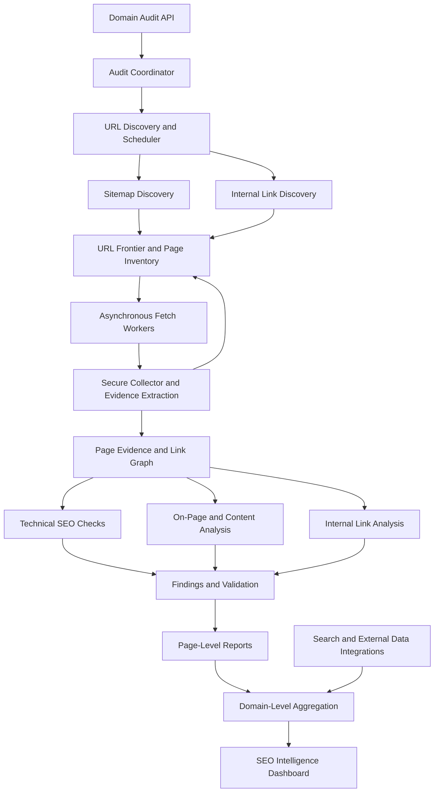

# Domain SEO Intelligence Platform

**An evidence-driven platform for full-domain SEO auditing, page-level intelligence, and continuous website optimization.**

## 1. Overview

The Domain SEO Intelligence Platform is designed to analyze an entire website rather than only its homepage. It discovers pages across a domain, collects technical and content evidence, evaluates SEO issues, and generates actionable reports for individual pages and the website as a whole.

The platform aims to help marketing and engineering teams understand how their website is structured, identify what is limiting search visibility, diagnose technical failures, improve content quality, and prioritize changes using evidence rather than assumptions.

The initial implementation establishes the foundation through single-page On-Page SEO and Technical SEO analysis. The long-term objective is to evolve this into a scalable, asynchronous, full-domain intelligence system with historical monitoring and search-performance analysis.

## 2. Problem Statement

A website consists of interconnected pages, resources, content, and technical dependencies. Analyzing only its homepage provides limited visibility into the website's overall SEO health.

Important problems include:

- Pages that are undiscovered, poorly connected, or difficult to crawl.
- Broken internal links, failed images, inaccessible resources, and redirect issues.
- Missing or inconsistent metadata, indexing signals, structured data, and technical configurations.
- Thin, duplicated, outdated, or insufficiently useful content.
- Important pages with weak internal linking or incomplete topic coverage.
- Limited visibility into page-level search performance and backlink profiles.
- Difficulty identifying which problems deserve attention first and why.

The platform addresses these problems by combining domain-wide crawling, structured evidence collection, deterministic SEO checks, AI-assisted content analysis, and consolidated reporting.

## 3. Project Objectives

1. **Full-domain discovery:** Discover eligible pages using sitemaps and internal links, with configurable crawl limits.
2. **Page-level analysis:** Produce an independent SEO report for every discovered page.
3. **Technical diagnostics:** Identify broken links, failed images, HTTP errors, indexing issues, metadata problems, and other technical findings.
4. **Content intelligence:** Evaluate relevance, topic coverage, usefulness, duplication, content structure, and trust signals.
5. **Site-wide analysis:** Understand internal-link relationships, crawl depth, orphan-page candidates, duplicate content, and related page opportunities.
6. **Search visibility analysis:** Integrate authorized search-performance and external backlink data to investigate page and query performance.
7. **Actionable recommendations:** Explain findings, supporting evidence, potential impact, and recommended corrective actions.
8. **Asynchronous execution:** Analyze pages independently and make completed results available without waiting for the entire domain.
9. **Continuous monitoring:** Detect meaningful changes, retain historical findings, and reanalyze affected pages efficiently.

## 4. Intended Workflow

A domain audit follows this high-level workflow:

1. **Submit a domain:** Create an audit and initialize its crawl configuration.
2. **Discover URLs:** Read available sitemaps, fetch eligible pages, and extract internal links.
3. **Build the page inventory:** Normalize and deduplicate URLs, record link relationships, and schedule eligible pages.
4. **Collect evidence:** Fetch page content and capture HTTP responses, metadata, resources, links, and relevant HTML structure.
5. **Analyze pages:** Run deterministic SEO checks and specialized AI-assisted analysis against the collected evidence.
6. **Generate page reports:** Persist findings and recommendations separately for each page as its analysis completes.
7. **Aggregate domain intelligence:** Combine page findings, internal-link relationships, and available search data into a consolidated website report.
8. **Monitor changes:** Compare subsequent crawls and update relevant findings, reports, and alerts.

The crawler and analysis pipeline will operate independently. A failed page or slow analysis task should not prevent unrelated pages from progressing.

## 5. System Architecture

The target architecture separates crawling, evidence collection, analysis, persistence, and reporting.

### Core components

| Component | Responsibility |
|---|---|
| Domain Audit API | Accept audit requests and expose progress and reports. |
| Audit Coordinator | Manage the audit lifecycle and coordinate discovery, processing, and aggregation. |
| URL Discovery and Scheduler | Discover, normalize, deduplicate, prioritize, and schedule eligible URLs. |
| Secure Collector | Fetch approved resources while enforcing URL validation, network security, timeouts, and crawl limits. |
| Page Evidence | Provide structured, reusable evidence to SEO checks and analysis agents. |
| SEO Analysis Agents | Evaluate technical SEO, on-page structure, content quality, and other supported analysis domains. |
| Findings and Validation | Store evidence-backed issues, severity, affected resources, and recommendations. |
| Persistence Layer | Store audit state, page snapshots, link relationships, findings, and report versions. |
| Domain Aggregator | Identify cross-page patterns, prioritize opportunities, and consolidate findings. |
| Monitoring Pipeline | Detect changes between crawls and schedule targeted reanalysis. |

## 6. SEO Analysis Capabilities

### A. Technical SEO

- HTTP status codes, redirect chains, inaccessible pages, and server errors.
- Titles, meta descriptions, heading structure, and canonical URLs.
- Robots directives, sitemap membership, and indexability signals.
- Broken internal links, failed images, missing alt attributes, and unavailable resources.
- Structured data, HTTPS issues, duplicate URL variants, and rendering problems.
- Page performance and Core Web Vitals where supporting measurements are available.

### B. On-Page and Content Intelligence

- Content relevance, search-intent alignment, and topic coverage.
- Main-content extraction and page-structure quality.
- Duplicate, near-duplicate, thin, or potentially outdated content.
- Heading quality, internal anchor text, and contextual linking.
- Authorship, factual support, usefulness, and relevant trust signals.
- Evidence-based recommendations for improving page content.

AI-generated content will not be treated as inherently low quality. The platform will evaluate observable content quality and usefulness rather than claim to reliably determine authorship from text alone.

### C. Domain-Wide Intelligence

- Sitemap and internal-link coverage.
- Crawl depth, incoming and outgoing links, and orphan-page candidates.
- Broken link relationships and weakly connected pages.
- Duplicate-content groups and potential competing pages.
- Important pages that may need stronger contextual internal links.
- Shared technical issues and recurring content-quality patterns.

### D. Search Performance and External Evidence

Where data sources are connected and available, the platform will analyze:

- Search queries, impressions, clicks, CTR, average position, and trends.
- Page-level visibility and changes in search performance.
- Potential keyword cannibalization and underperforming queries.
- External backlinks, referring domains, and competitor-page evidence.
- Relevant gaps between current page content and competing pages.

The system will distinguish measured search performance from hypotheses about ranking causes. A crawl alone cannot establish why a search engine ranks one page above another.

## 7. Reporting and Recommendations

Each discovered page will have its own report containing:

- URL, crawl status, page type, and collection timestamp.
- Technical SEO findings and affected resources.
- On-page and content-quality observations.
- Internal-link relationships and relevant domain context.
- Search-performance metrics where available.
- Evidence supporting each finding.
- Severity, potential impact, and recommended corrective action.
- Previous findings and changes when historical data is available.

The consolidated domain report will summarize overall crawl coverage, technical issues, content opportunities, internal-link weaknesses, page-level performance patterns, and prioritized actions.

Recommendations will explain **what is wrong, where it occurs, what evidence supports the finding, why it matters, and what the team should do next.**

## 8. Technology Stack

### Existing foundation

- Python
- Django REST Framework
- Existing audit coordinator and secure collector
- Shared `PageEvidence` structure
- Agent registry and structured findings
- Existing On-Page SEO and Technical SEO agents
- Current database and reporting implementation

### Planned extensions

- Sitemap and full-domain crawling with a persistent URL frontier.
- Asynchronous task processing, potentially using Celery and Redis.
- PostgreSQL-backed page inventory, snapshots, link relationships, and report history, aligned with the existing database.
- Selective browser rendering for JavaScript-dependent pages.
- Search Console, PageSpeed Insights, and optional backlink-provider integrations.
- Dashboard capabilities for crawl progress, page reports, site-wide findings, and historical changes.

Planned technologies are architectural choices to validate against the existing codebase, not claims that these integrations are already implemented.

## 9. Development Roadmap

| Stage | Focus | Expected outcome |
|---|---|---|
| 1. Existing foundation | Single-page collection and SEO analysis | Establish reliable page-level evidence and findings. |
| 2. Domain discovery | Sitemaps, internal links, URL normalization, deduplication | Build a persistent inventory of discovered pages. |
| 3. Asynchronous processing | Independent fetch and analysis tasks | Process pages concurrently and expose partial results. |
| 4. Page reporting | Persisted findings and individual page reports | Generate a report for every analyzed page. |
| 5. Domain intelligence | Link graph, duplicate content, shared issues, prioritization | Identify cross-page problems and opportunities. |
| 6. Search intelligence | Search-performance and backlink integrations | Investigate measured visibility and potential ranking factors. |
| 7. Continuous monitoring | Scheduled crawls, change detection, incremental reanalysis | Maintain current reports and track meaningful changes. |

## 10. Reliability, Security, and Design Principles

- **Evidence first:** Findings must be traceable to collected evidence or a named external data source.
- **Asynchronous by design:** Independent page tasks must not block one another.
- **Bounded crawling:** Enforce domain scope, URL limits, timeouts, response-size limits, and per-host request limits.
- **Secure collection:** Prevent SSRF, unsafe redirects, and access to internal network resources.
- **Idempotent processing:** Retries must not create duplicate crawl jobs or findings.
- **Incremental analysis:** Reanalyze changed evidence and affected dependencies where possible.
- **Historical traceability:** Preserve meaningful changes between audit runs.
- **Honest reporting:** Clearly distinguish observed facts, interpretations, unavailable data, and unverified hypotheses.
- **Backward compatibility:** Extend the existing application without unnecessarily replacing its working components.

## 11. Current Status

The project currently has a foundational single-page SEO audit workflow with On-Page SEO and Technical SEO analysis. The first bounded discovery step is also implemented: each audit persists a breadth-first, same-host crawl frontier, sitemap/page discoveries, and internal-link edges while preserving the existing single-page evidence and API response. This is the starting point for the larger platform, not the completed product.

Discovery removes URL fragments, normalizes trailing slashes, preserves query strings, rejects external hosts, revalidates secure redirects through the existing collector, and enforces configurable page, depth, sitemap, response, timeout, redirect, and per-host request limits. Pages are not analyzed as part of discovery; they remain available for a later worker-based analysis phase.

The immediate development priority is full-domain URL discovery and persistent crawl state. Subsequent stages will introduce asynchronous processing, independent page reports, domain-wide analysis, search-performance integrations, and continuous monitoring.

Phase 4 adds a separate seed-only batch API without changing the single-page audit API:

- `POST /api/batches/` accepts 1-25 validated URLs and an idempotency key.
- `GET /api/batches/<batch_id>/` returns batch progress and per-target evidence.
- `POST /api/batches/<batch_id>/resume/`, `/retry/`, and `/cancel/` manage bounded lifecycle actions.
- The configured 25-page IB tutoring seed set is available in `audits/batch_seeds.py`; callers still submit it as input.
- Seed-only mode is the default. Optional bounded same-host internal-link discovery is enabled with `allow_internal_discovery`.
- Batch targets retain the submitted URL separately from its normalized and redirect final URLs. Non-HTML responses are recorded as non-HTML evidence rather than HTML SEO failures.

Batch execution is asynchronous and bounded: targets are collected in parallel waves using
`SEO_BATCH_WORKERS` (four workers by default), while each status response exposes completed,
failed, skipped, and still-pending targets. Cancellation is checked between waves, and SQLite
uses serialized execution because its write locking is incompatible with concurrent workers.

Phase 7 provider evidence is optional and server-side only. Search Console and backlink
configuration remains explicit and unverified until a live client is enabled. GA4 landing-page
exports can be attached through `GA4_IMPORT_DIR`; each JSON file must contain `pages` (or
`rows`) with `landing_page`/`url` and available metrics such as `sessions`,
`organic_sessions`, `referral_sessions`, and `conversions`. Missing provider data remains
unavailable and is exposed through `GET /api/providers/status/`; credentials are never returned
by the API.

## Project Vision

Build a reliable, evidence-driven SEO intelligence platform that gives marketing and engineering teams visibility into every important page of a website, explains its technical and content weaknesses, connects page-level findings with domain-wide patterns, and helps teams prioritize improvements using measurable evidence.